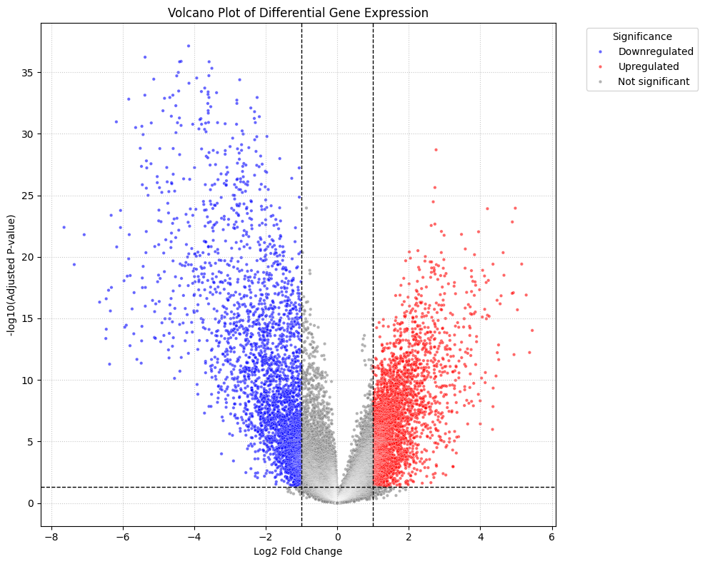
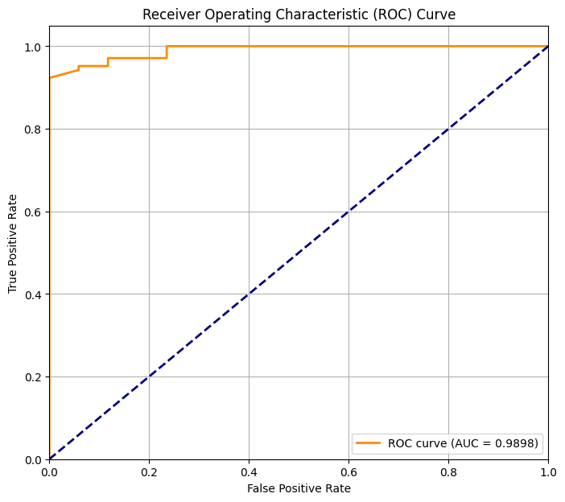
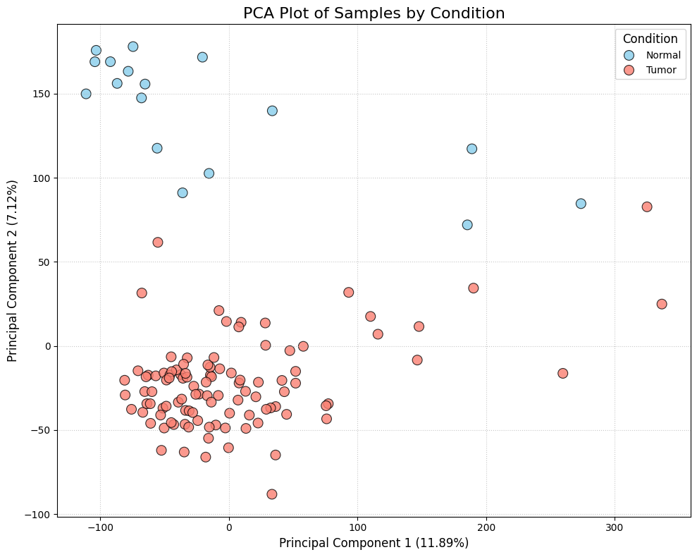
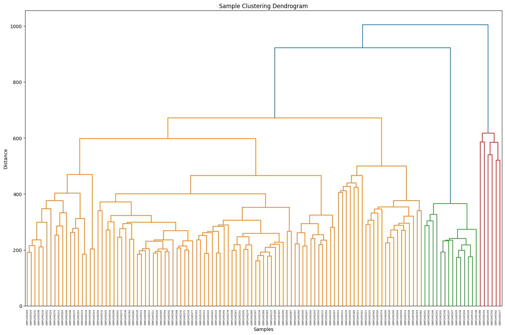
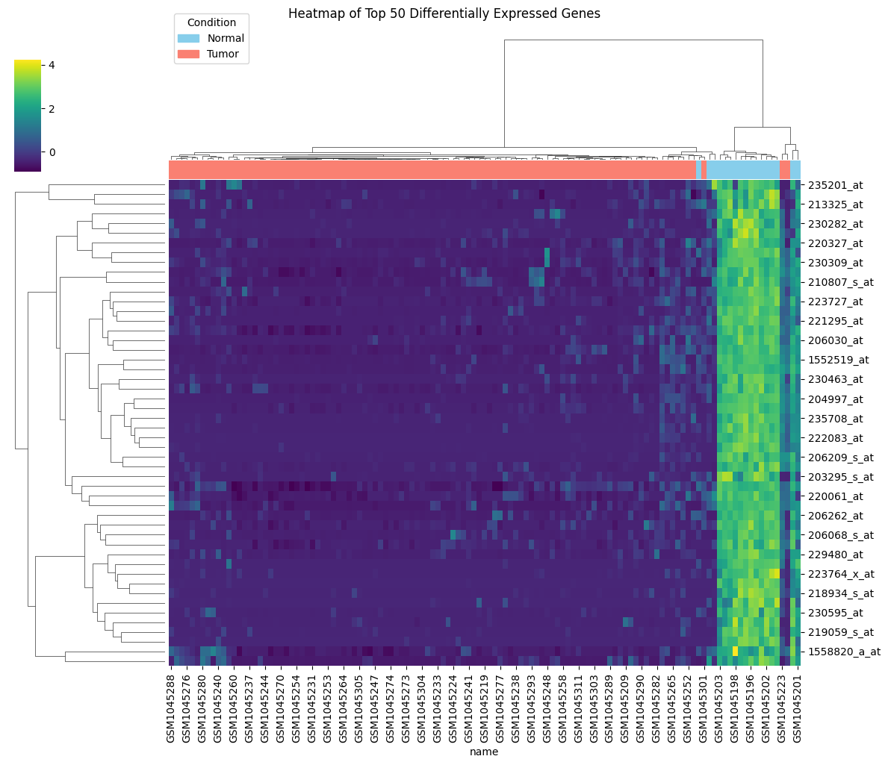
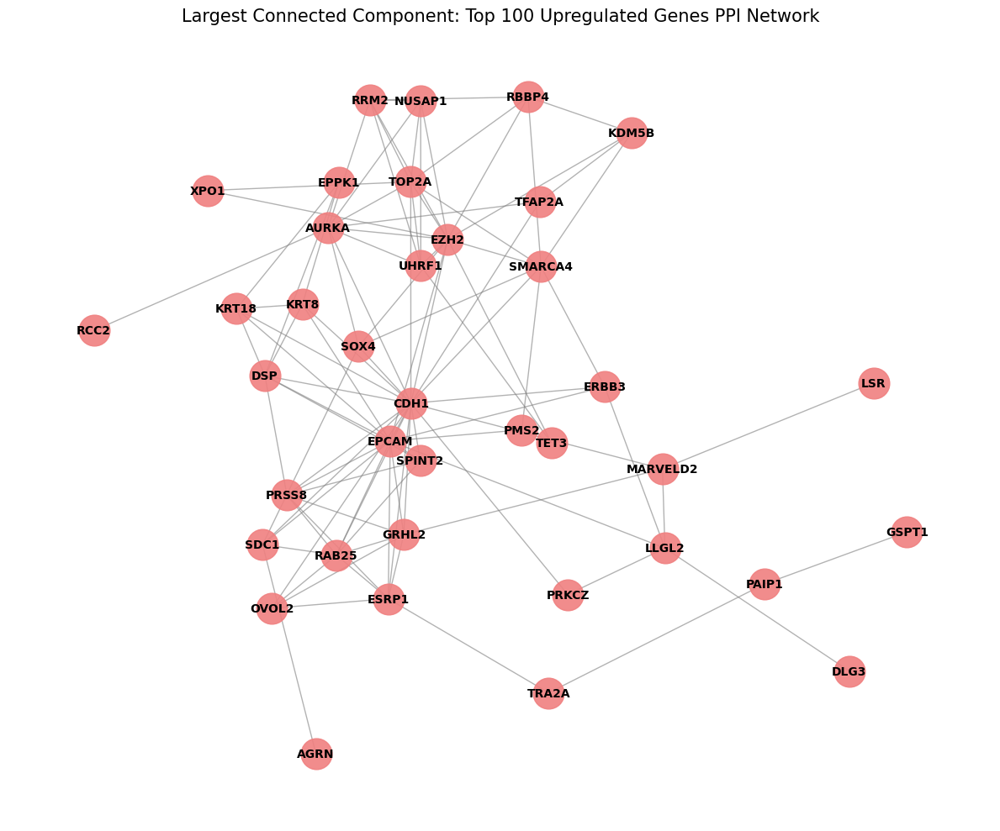
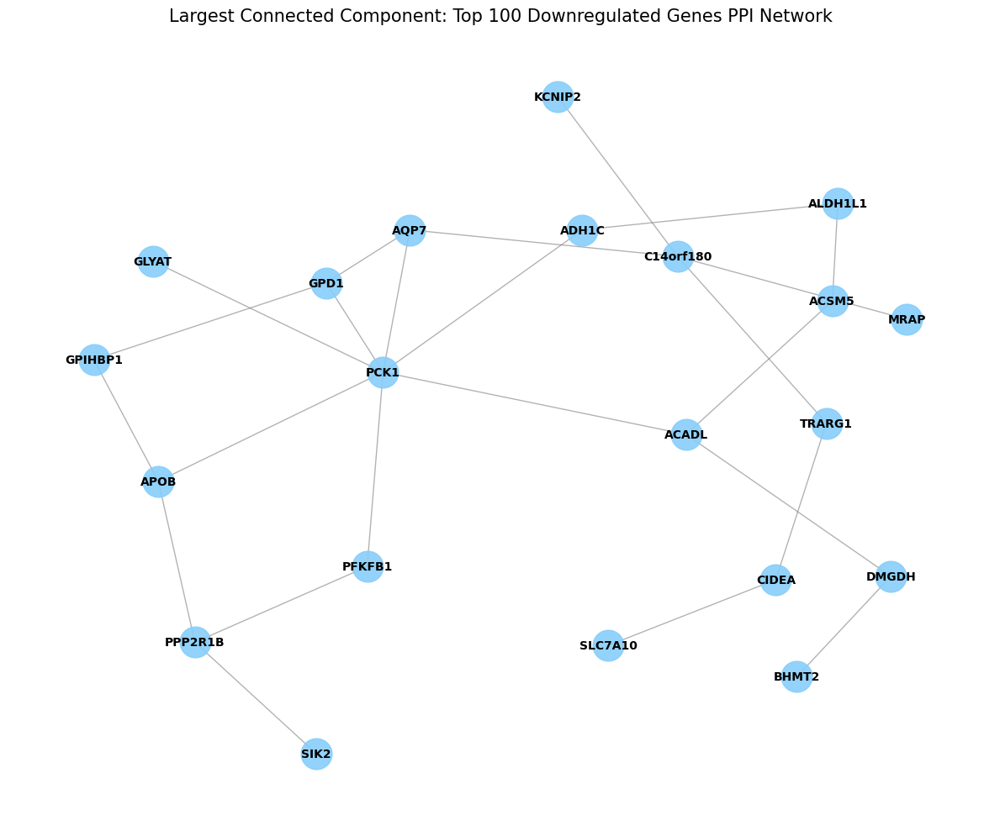
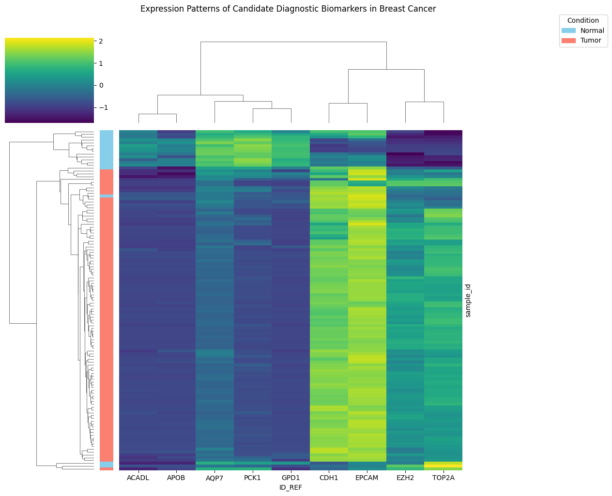
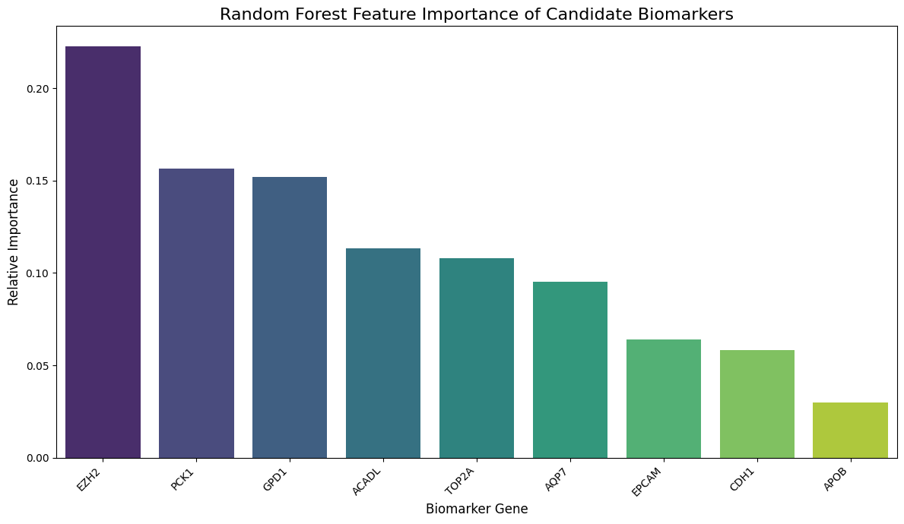

# Identification of Potential Biomarkers in Breast Cancer Using Transcriptomics

An end-to-end bioinformatics pipeline that takes public breast cancer microarray data, finds the genes that differ between tumour and normal breast tissue, places them in biological context (pathways, protein–protein interaction networks), narrows them down to a small panel of candidate biomarkers, and tests how well that panel separates tumour from normal samples with a machine-learning classifier.

The whole analysis is in one Jupyter notebook, [`notebooks/breast_cancer_biomarker_discovery.ipynb`](notebooks/breast_cancer_biomarker_discovery.ipynb). It was built and run on Google Colab and combines Python with R/Bioconductor (`limma`) through `rpy2`.

<p align="center">
  
  
</p>

---

## Table of Contents

1. [Background](#background)
2. [Dataset](#dataset)
3. [Pipeline Overview](#pipeline-overview)
4. [Methods (Step by Step)](#methods-step-by-step)
5. [Key Results](#key-results)
6. [Repository Structure](#repository-structure)
7. [Getting Started](#getting-started)
8. [Outputs Generated](#outputs-generated)
9. [Limitations and Caveats](#limitations-and-caveats)
10. [Future Work](#future-work)
11. [References](#references)

---

## Background

Breast cancer is the most commonly diagnosed cancer in women worldwide. **Transcriptomics**, the measurement of genome-wide gene expression, shows which genes are switched on or off in tumour tissue compared with healthy tissue. Genes that change consistently and strongly, and that sit at important points in biological networks, are good candidates for **biomarkers**: molecular indicators that could support diagnosis, prognosis or treatment selection.

This project asks:

> *Which genes are most strongly and reliably dysregulated in breast tumours compared with normal breast tissue, and can a small panel of them accurately tell the two apart?*

## Dataset

| Property | Value |
|---|---|
| **Accession** | [GSE42568](https://www.ncbi.nlm.nih.gov/geo/query/acc.cgi?acc=GSE42568) (NCBI Gene Expression Omnibus) |
| **Platform** | Affymetrix Human Genome U133 Plus 2.0 Array (GPL570) |
| **Samples** | 121 in total: **104 breast cancer** and **17 normal breast** tissue |
| **Features** | 54,675 microarray probe sets |
| **Values** | Pre-processed, log2-scale expression values as deposited in GEO |

The notebook downloads the data automatically with `GEOparse`, so nothing has to be fetched by hand. Sample labels come from the `characteristics_ch1` field (`tissue: normal breast` vs. `tissue: breast cancer`).

## Pipeline Overview

```
 GEO (GSE42568)
      │  GEOparse
      ▼
 ┌──────────────────────┐
 │ 1. Load & label data  │  expression matrix (54,675 × 121) + metadata
 └──────────┬───────────┘
            ▼
 ┌──────────────────────┐
 │ 2. QC & exploration   │  boxplots · PCA · hierarchical clustering
 └──────────┬───────────┘
            ▼
 ┌──────────────────────┐
 │ 3. Differential expr. │  limma (R) · FDR < 0.05 · |log2FC| > 1
 └──────────┬───────────┘
            ▼
 ┌──────────────────────┐
 │ 4. Export & plots     │  Excel tables · volcano · heatmap · PCA
 └──────────┬───────────┘
            ▼
 ┌──────────────────────┐
 │ 5. ORA enrichment     │  probe→symbol (mygene) · Enrichr GO-BP & KEGG
 └──────────┬───────────┘
            ▼
 ┌──────────────────────┐
 │ 6. Preranked GSEA     │  KEGG 2021 · MSigDB Hallmark 2020
 └──────────┬───────────┘
            ▼
 ┌──────────────────────┐
 │ 7. PPI network        │  STRING API · NetworkX · degree-based hub genes
 └──────────┬───────────┘
            ▼
 ┌──────────────────────┐
 │ 8. Biomarker shortlist│  hub ∩ strong DE ∩ enriched pathways → 9 genes
 └──────────┬───────────┘
            ▼
 ┌──────────────────────┐
 │ 9. ML validation      │  Random Forest · stratified 5-fold CV · ROC/AUC
 └──────────────────────┘
```

## Methods (Step by Step)

### Step 1: Data acquisition and labelling
- `GEOparse.get_GEO("GSE42568")` downloads and parses the SOFT file.
- `pivot_samples('VALUE')` builds a **probe × sample** expression matrix (54,675 × 121).
- Per-sample metadata is flattened into a table (121 × 33), and each sample is labelled **Tumor** or **Normal** from its `characteristics_ch1` annotation.

### Step 2: Quality control and exploratory analysis
- **Per-sample boxplots** check that the samples have comparable expression distributions, which shows whether the deposited data are already normalised and free of obvious technical outliers.
- **PCA** on standardised (z-scored) expression shows that tumour and normal samples form clearly separate groups (PC1 ≈ 11.9 %, PC2 ≈ 7.1 % of variance).
- **Hierarchical clustering** (Ward linkage) confirms that the samples group mostly by tissue type.

| PCA | Sample dendrogram |
|---|---|
|  |  |

### Step 3: Differential expression analysis with `limma`
- R's Bioconductor **`limma`** package is called from Python via **`rpy2`**.
- Design matrix: `~0 + group` with levels `Normal` and `Tumor`; contrast **Tumor − Normal**.
- Pipeline: `lmFit` → `contrasts.fit` → `eBayes` (empirical-Bayes moderated t-statistics) → `topTable` with Benjamini–Hochberg FDR correction.
- **Significance thresholds:** adjusted p-value (FDR) **< 0.05** and **|log2 fold-change| > 1** (at least a two-fold change).

### Step 4: Export and publication-quality figures
- DEG tables are written to multi-sheet Excel workbooks (full table, top up/down genes, top 50/100 DEGs).
- The **volcano plot** shows effect size against significance for every probe.
- The **clustered heatmap** of the top 50 DEGs (row z-scores, Ward linkage) shows a clear split between tumour and normal samples.



### Step 5: Over-representation analysis (GO and KEGG)
- Affymetrix probe IDs are mapped to HGNC gene symbols with **`mygene`** (scope `reporter`). About 43.5 k of the 54.7 k probes map to a symbol.
- Up- and down-regulated gene lists are tested separately with **Enrichr** (via `gseapy.enrichr`) against:
  - `GO_Biological_Process_2021`
  - `KEGG_2021_Human`

### Step 6: Preranked Gene Set Enrichment Analysis (GSEA)
- Every mapped gene is ranked by log2FC (duplicate symbols are averaged).
- `gseapy.prerank` is run with 1,000 permutations, gene-set sizes from 15 to 500, and `seed=42`, against:
  - `KEGG_2021_Human`
  - `MSigDB_Hallmark_2020`
- Positive NES means the gene set is enriched among genes up-regulated in tumours; negative NES means it is enriched among down-regulated genes.

### Step 7: Protein–protein interaction (PPI) network analysis
- The top 100 up-regulated and top 100 down-regulated DEGs are sent to the **STRING REST API** (human, taxon 9606, medium confidence ≥ 0.4).
- Interactions are loaded into **NetworkX** graphs, and **hub genes** are ranked by **degree centrality** (number of interaction partners).

| Up-regulated network (largest component) | Down-regulated network (largest component) |
|---|---|
|  |  |

### Step 8: Candidate biomarker selection
Candidates were chosen by combining three lines of evidence:
1. **Network centrality:** among the top 10 hubs of the up- or down-regulated PPI network.
2. **Strong differential expression:** large |log2FC| and very small FDR.
3. **Pathway relevance:** membership in significantly enriched GSEA/ORA pathways.

This produced a panel of **9 candidate biomarkers**, which is saved to `candidate_biomarkers.csv`.

### Step 9: Machine-learning validation
- **Features:** expression of one representative probe per candidate gene (9 features).
- **Model:** `RandomForestClassifier(n_estimators=100, random_state=42)`.
- **Validation:** **stratified 5-fold cross-validation**, with `StandardScaler` fitted inside each training fold so that no scaling information leaks into the test fold.
- **Metrics:** out-of-fold predictions are pooled and used for the ROC curve and AUC. The decision threshold is chosen by Youden's J, and accuracy, precision, sensitivity, specificity and F1 are computed at that threshold.
- **Interpretation:** Random Forest feature importances are averaged over the five folds.

---

## Key Results

### Differential expression
| Category | Probe sets (FDR < 0.05, \|log2FC\| > 1) |
|---|---|
| Up-regulated in tumour | **3,386** |
| Down-regulated in tumour | **3,085** |
| **Total DEGs** | **6,471** |

The most up-regulated genes are epithelial genes such as **EPCAM, DSP, KRT18, SDC1 and S100P**. The most down-regulated genes are adipocyte and stromal genes such as **LEP, FABP4, PLIN1, TIMP4 and LPL**. This fits the known biology: tumours are dense with epithelial cells, whereas normal breast tissue is rich in fat.

### Pathway enrichment
**Up-regulated in tumours: proliferation and the cell cycle**
- Hallmark GSEA: **E2F Targets** (NES = +2.37), **G2-M Checkpoint** (NES = +2.24), **Interferon-α Response** (NES = +1.88), all with FDR ≤ 0.001
- GO-BP: mitotic spindle organisation, sister chromatid segregation, DNA replication
- KEGG (ORA): Fanconi anaemia pathway, tight junction, transcriptional misregulation in cancer, ECM–receptor interaction

**Down-regulated in tumours: lipid and energy metabolism**
- Hallmark GSEA: **Adipogenesis** (NES = −2.51), **Fatty Acid Metabolism** (NES = −2.17), **Oxidative Phosphorylation** (NES = −2.00)
- KEGG GSEA: **PPAR signalling** (NES = −2.18), regulation of lipolysis in adipocytes, fatty acid degradation, pyruvate metabolism, TCA cycle
- GO-BP: fatty acid β-oxidation, regulation of angiogenesis, focal adhesion assembly

### Hub genes from the PPI networks
| Up-regulated hubs (degree) | Down-regulated hubs (degree) |
|---|---|
| CDH1 (20), EPCAM (14), EZH2 (13), AURKA (9), TOP2A (9), RAB25 (8), SMARCA4 (8), PRSS8 (7), ESRP1 (7), DSP (7) | PCK1 (7), C14orf180 (4), APOB (3), ACADL (3), PPP2R1B (3), AQP7 (3), GPD1 (3), ANGPT1 (3), GPIHBP1 (2), VEGFD (2) |

### Candidate biomarker panel
log2FC and FDR are the limma values for the hub genes (notebook Step 8, `merged_hub_deg_info`).

| Gene | Direction | log2FC | FDR | Main biological theme |
|---|---|---|---|---|
| **EPCAM** | ↑ | +5.16 | 3.9e-20 | Epithelial cell adhesion; established carcinoma marker |
| **CDH1** | ↑ | +4.89 | 9.2e-18 | E-cadherin; epithelial adhesion / EMT |
| **TOP2A** | ↑ | +4.55 | 6.5e-17 | DNA topology, proliferation; anthracycline target |
| **EZH2** | ↑ | +3.75 | 1.3e-19 | PRC2 epigenetic silencer; E2F targets / G2-M |
| **PCK1** | ↓ | −6.18 | 1.1e-31 | Gluconeogenesis; PPAR signalling, TCA cycle |
| **GPD1** | ↓ | −5.38 | 7.4e-34 | Glycerolipid metabolism; adipogenesis |
| **AQP7** | ↓ | −4.41 | 5.0e-29 | Glycerol transport; adipogenesis, lipolysis |
| **ACADL** | ↓ | −3.61 | 4.0e-34 | Mitochondrial fatty acid β-oxidation |
| **APOB** | ↓ | −2.79 | 2.5e-28 | Lipoprotein / lipid transport |



### Classifier performance (9-gene panel, stratified 5-fold CV)
| Metric | Value |
|---|---|
| **ROC AUC** | **0.990** |
| Accuracy | 0.934 |
| Precision (Tumor) | 1.000 |
| Sensitivity / Recall (Tumor) | 0.923 |
| Specificity | 1.000 |
| F1-score | 0.960 |

Confusion matrix (out-of-fold predictions at threshold 0.90):

|  | Predicted Normal | Predicted Tumor |
|---|---|---|
| **Actual Normal** | 17 | 0 |
| **Actual Tumor** | 8 | 96 |

**Most informative features (mean RF importance):** EZH2 (0.223) > PCK1 (0.156) > GPD1 (0.152) > ACADL (0.114) > TOP2A (0.108) > AQP7 (0.095) > EPCAM (0.064) > CDH1 (0.058) > APOB (0.030)



### Biological interpretation
The panel captures **two complementary hallmarks of breast cancer**:
- **Increased proliferation and epigenetic reprogramming** (EZH2, TOP2A), together with an **epithelial identity** (EPCAM, CDH1).
- **Metabolic reprogramming and loss of the adipose microenvironment** (PCK1, GPD1, ACADL, AQP7, APOB): lower gluconeogenesis, lipid storage and fatty acid oxidation in tumour tissue.

---

## Repository Structure

```
.
├── README.md                     ← you are here
├── requirements.txt              ← Python dependencies
├── .gitignore
├── notebooks/
│   └── breast_cancer_biomarker_discovery.ipynb   ← full analysis (with saved outputs)
├── figures/                      ← key figures extracted from the notebook
│   ├── 01_qc_boxplot.png
│   ├── 02_pca_qc.png
│   ├── 03_sample_dendrogram.png
│   ├── 04_volcano_plot.png
│   ├── 05_heatmap_top50_degs.png
│   ├── 06_pca_by_condition.png
│   ├── 07_ppi_top10_hubs.png
│   ├── 08_ppi_upregulated_lcc.png
│   ├── 09_ppi_downregulated_lcc.png
│   ├── 10_roc_curve.png
│   ├── 11_feature_importance.png
│   └── 12_heatmap_candidate_biomarkers.png
├── data/                         ← raw GEO downloads go here (git-ignored)
└── results/                      ← place to keep regenerated tables (git-ignored)
```

## Getting Started

### Option A: Google Colab (easiest)
1. Open [Google Colab](https://colab.research.google.com/) and choose **File → Upload notebook** (or **GitHub** and paste this repository's URL).
2. Select `notebooks/breast_cancer_biomarker_discovery.ipynb`.
3. **Runtime → Run all.** The notebook installs its own Python packages with `!pip install`, and Colab already includes R, so `rpy2`/`limma` work without extra setup.

### Option B: Run locally
**Prerequisites:** Python ≥ 3.10, R ≥ 4.2, and an internet connection (GEO, mygene.info, Enrichr and STRING are all queried live).

```bash
# 1. Clone
git clone https://github.com/<your-username>/<repo-name>.git
cd <repo-name>

# 2. Python environment
python -m venv .venv
source .venv/bin/activate          # Windows: .venv\Scripts\activate
pip install -r requirements.txt

# 3. R / Bioconductor packages (used through rpy2)
Rscript -e 'if (!requireNamespace("BiocManager", quietly=TRUE)) install.packages("BiocManager", repos="https://cloud.r-project.org"); BiocManager::install(c("limma","Biobase"), ask=FALSE, update=FALSE)'

# 4. Launch
jupyter notebook notebooks/breast_cancer_biomarker_discovery.ipynb
```

> **Note:** The notebook writes all of its outputs (Excel files, PNGs, GSEA folders) to the **current working directory**, which is `notebooks/` when you launch it as shown above. These files are git-ignored so they do not clutter the repository. The full run takes roughly 10–20 minutes, mostly spent on downloads and GSEA permutations.

## Outputs Generated

Running the notebook end-to-end produces:

| File / folder | Contents |
|---|---|
| `GSE42568_DEG_results.xlsx` | Full limma table, top 20 up/down, top 50 DEGs (probe IDs) |
| `GSE42568_DEG_results_with_symbols.xlsx` | Same tables annotated with gene symbols (top 50 up/down, top 100 overall) |
| `volcano_plot.png`, `heatmap_top_50_degs.png`, `pca_plot_by_condition.png` | Publication-quality DE figures (300 dpi) |
| `GO_BP_*_dotplot.png`, `KEGG_*_dotplot.png` | Enrichr dot plots for up/down gene sets |
| `GSEA_KEGG_results/`, `GSEA_Hallmark_results/` | Full GSEA reports plus one enrichment-curve PDF per gene set |
| `upregulated_ppi_network_lcc.png`, `downregulated_ppi_network_lcc.png` | PPI network figures |
| `candidate_biomarkers.csv` | The 9-gene panel with pathways and selection rationale |
| `roc_curve.png`, `feature_importance.png`, `heatmap_candidate_biomarkers.png` | Classifier evaluation figures |

## Limitations and Caveats

Please keep these points in mind when interpreting the results:

- **Optimistic classifier estimate (selection bias).** The 9 biomarkers were chosen using *all* 121 samples (limma + PPI) before cross-validation. Because feature selection happened outside the CV loop, the reported AUC of 0.99 is likely **higher than the panel would achieve on new data**. A proper estimate needs either nested CV (repeating DE-based selection inside each fold) or an **independent validation cohort** (for example TCGA-BRCA, or another GEO series such as GSE15852 or GSE10810).
- **Class imbalance.** There are only 17 normal samples compared with 104 tumours. Specificity therefore rests on very few samples, and the Youden-optimal threshold (0.90) is fitted to the same pooled predictions it is evaluated on.
- **Tissue composition confound.** Normal breast tissue is mostly fat, so the many "down-regulated" metabolic genes (PCK1, GPD1, AQP7, ACADL, LEP, FABP4…) may reflect **differences in adipocyte content** rather than changes inside tumour cells. Deconvolution (for example xCell or CIBERSORTx) or purity adjustment would help separate the two.
- **Probe-level analysis.** DE was run on probes rather than collapsed genes. Several probes can map to one gene, and the ML step uses the *first* probe found for each symbol, which may not be the most informative one.
- **Hand-entered values in Step 8.** The `candidate_biomarkers` table in the notebook contains approximate, hand-entered log2FC/FDR values that differ from the limma output for some genes (for example CDH1). The table in this README uses the limma-computed values from `merged_hub_deg_info`.
- **Live web services.** mygene.info, Enrichr and STRING are queried online, so results can change slightly as those databases are updated.
- **Diagnostic, not prognostic.** The panel separates tumour from normal tissue. It has **not** been tested for subtype, survival or treatment response.

## Future Work
- Validate the panel in independent cohorts (TCGA-BRCA RNA-seq, METABRIC).
- Use nested cross-validation with feature selection inside each fold.
- Add survival analysis (Kaplan–Meier / Cox) for prognostic value.
- Analyse by PAM50 subtype (Luminal A/B, HER2-enriched, Basal-like).
- Adjust for tumour purity and stromal/adipose content.
- Compare against other classifiers (logistic regression with L1, SVM, XGBoost) and calibrate probabilities.
- Refactor the notebook into reusable Python modules or a Snakemake workflow.

## References

1. Clarke C. *et al.* (2013). Correlating transcriptional networks to breast cancer survival: a large-scale coexpression analysis. *Carcinogenesis*, 34(10):2300–2308. (GSE42568)
2. Ritchie M.E. *et al.* (2015). limma powers differential expression analyses for RNA-sequencing and microarray studies. *Nucleic Acids Research*, 43(7):e47.
3. Subramanian A. *et al.* (2005). Gene set enrichment analysis: a knowledge-based approach for interpreting genome-wide expression profiles. *PNAS*, 102(43):15545–15550.
4. Fang Z., Liu X., Peltz G. (2023). GSEApy: a comprehensive package for performing gene set enrichment analysis in Python. *Bioinformatics*, 39(1):btac757.
5. Kuleshov M.V. *et al.* (2016). Enrichr: a comprehensive gene set enrichment analysis web server 2016 update. *Nucleic Acids Research*, 44(W1):W90–W97.
6. Szklarczyk D. *et al.* (2023). The STRING database in 2023. *Nucleic Acids Research*, 51(D1):D638–D646.
7. Liberzon A. *et al.* (2015). The Molecular Signatures Database Hallmark Gene Set Collection. *Cell Systems*, 1(6):417–425.
8. Pedregosa F. *et al.* (2011). Scikit-learn: Machine Learning in Python. *JMLR*, 12:2825–2830.

---

### Author
**Deepesh Kumar**

*This project is for research and educational purposes only. It is not intended for clinical use.*
